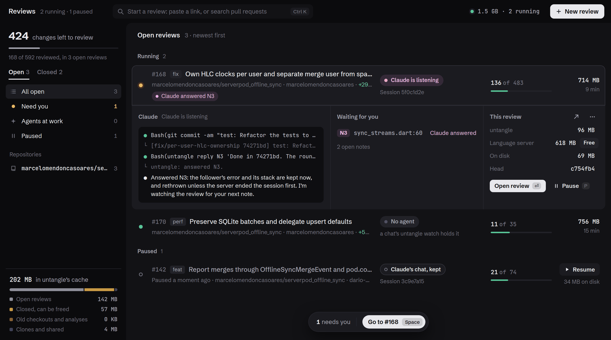
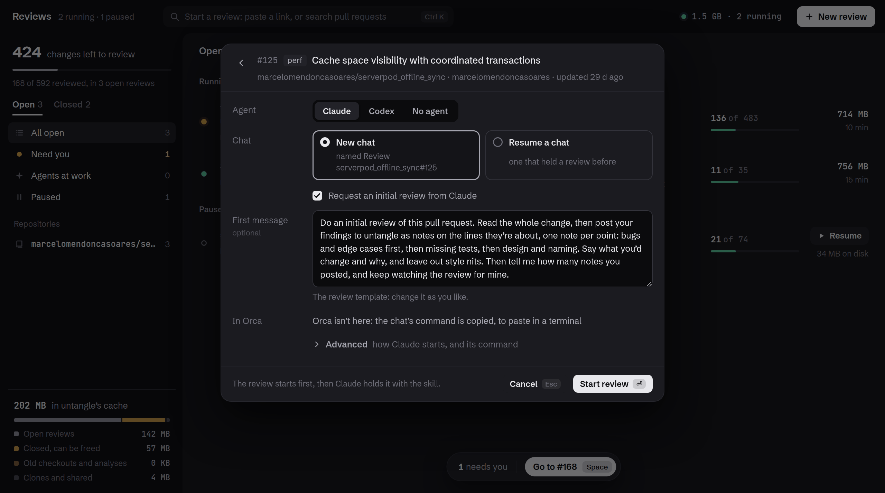

# `untangle`


Review a pull request by what changed, not file by file. `untangle` follows each change across
files, reads a rename or a repeated edit once, keeps generated code out of the count, and
remembers what you reviewed down to the line, across new pushes. It runs on your machine, reads
Dart, and opens in your browser.


- [`untangle`](#untangle)
  - [Overview](#overview)
  - [Features](#features)
    - [Chains, not files](#chains-not-files)
    - [A rename is one change](#a-rename-is-one-change)
    - [Mark changes, not files](#mark-changes-not-files)
    - [Go to definition anywhere](#go-to-definition-anywhere)
    - [Tests as sentences](#tests-as-sentences)
    - [The commits, as a lens](#the-commits-as-a-lens)
    - [The pull request's conversation](#the-pull-requests-conversation)
    - [Review with your agent](#review-with-your-agent)
    - [Every review on one page](#every-review-on-one-page)
    - [Start a review with its agent](#start-a-review-with-its-agent)
    - [And more](#and-more)
  - [Getting started](#getting-started)
    - [1. Install the requirements](#1-install-the-requirements)
    - [2. Build `untangle`](#2-build-untangle)
    - [3. Open a review](#3-open-a-review)
  - [Usage](#usage)
    - [What it reviews](#what-it-reviews)
    - [Where it opens](#where-it-opens)
    - [Generated code](#generated-code)
    - [With a coding agent](#with-a-coding-agent)
    - [Your reviews](#your-reviews)
    - [Upgrading](#upgrading)
    - [Keys](#keys)
    - [Flags](#flags)
  - [How it works](#how-it-works)
  - [Storage](#storage)
  - [Development](#development)
  - [Credits](#credits)
  - [License](#license)

---

## Overview

`untangle` began with a frustration. Reviewing code takes more and more of the day, and while AI
agents changed how code gets written, they didn't change how it gets reviewed. We still read text
files, beautifully colorized, with nice shortcuts and search, but text files. And reviewing code
is not reviewing text.

A pull request is a few decisions and the code each one drags along. Once you approve a model
change, its migration has nothing left to tell you. Once you approve a renamed parameter in its
signature, the same rename at every call site is noise. Generated code fills the file list and
the line count, even when `.gitattributes` marks it. And a file marked as viewed stays that way
only until the next push touches it: then the whole file is new again, and you hunt for the part
that changed.

So the question was what a review would look like if the tool read code instead of text. 

`untangle` reads a pull request the way it was written, following its commits without their
churn. Each change is a chain, named after the commit that started it and followed across files.
When later commits rework code an earlier one added, those edits fold into the earlier commit's
chain, so you read the code as it ended up, not every version it went through. A rename or a
repeated edit reads once. You mark changes, not files, and your marks live in a git branch, so a
new push brings back only what changed since you looked. The same diff always gives the same
review.

## Features

### Chains, not files

A chain is one change followed across files: the commit that started it, the calls it changed,
and the code that had to change in turn. Each commit and the commits that later touched its lines
make one chain, named after it and opening with its message, so back-and-forths don't repeat. A
chain reads as a graph of what each change uses; the map shows which chains build on which.
`-chains structure` follows the code alone, without the commits.


### A rename is one change

The same edit in many places reads once. In #168, `spaceId → userId` is 126 changes in 31 files
and one row in the sidebar: each place shows its whole edit, and they can be marked together or
one at a time. Moved code shows only its real edits, with the old copy as one line that opens the
new one. [Generated code](#generated-code), migrations included, is not reviewed or counted, and
opens read-only.


### Mark changes, not files

Space marks the change in front of you and goes to the next; the pill under the code says where
you are among the changes left ("1 of 224"). Reviewed code stays on screen, muted, and a hunk
folds away once its last change is reviewed. Your review is kept in git: the base plus every
change you marked. A new push brings back only what changed since you looked, and a rebase
replays your marks onto the new base.


### Go to definition anywhere

Click a name on any line, added or removed, to read its definition in place. Names on changed
lines answer at once; any other name asks the Dart language server, from the base or the head.
A click inside the peek follows the next name. A name clicked where it's declared lists its usages
instead, and a class's or a method's peek lists its implementations: the classes that extend or
implement it, or the methods that override it. Ctrl K jumps to a chain, a file, a thread or any
declaration in the repository, and searches the code.


### Tests as sentences

A test's group and test titles join into the sentence it asserts: Given …, when …, then ….
The Tests view lists every sentence the pull request adds, rewords, regroups or removes, with the
reworded words marked and the commit that wrote each. A chain shows the test files it changes the
same way. Reviewed tests fold into one line, and a test file can be reviewed whole. A test's
details (its expects, the lines it changed, its commit) show as the pointer rests on it; on a
touch screen they show on every test, and ⋯ can keep them to the test you open.


### The commits, as a lens

The Commits tab draws the pull request's commits as a graph. Pick one, or a range, and every view
reviews through it: lines from other commits fade, and the counts, the pill and the keys go
through its changes. After a new push, "Since your review" shows what changed since you last
looked. History shows each commit with its files, checks and reviews, and the heads a force push
replaced.


### The pull request's conversation

Comments go to the pull request through `gh`, and its threads show under their lines, with
replies, reactions and suggestions. Comment on a line, a range or a file, resolve threads, and
submit your review.


### Review with your agent

When an agent wrote the code, keep your comments as local notes for it. With the
[untangle skill](#with-a-coding-agent), ask in its chat, "review this in untangle": the review
opens, your notes reach the agent as you write them, and it answers in their threads, commits and
resolves what it fixed. Ask for its review too, and it writes notes of its own. It works with
Claude and Codex, and *Copy for agent* takes the notes to any other chat.


### Every review on one page

`untangle reviews` opens a page with every review on your machine: running, paused or closed,
each with its progress, its agent, and what waits for you. Open a row to read the agent's last
steps and the notes it left you, and Space opens the next review that needs you. Pause a review to
give its memory back, and Resume brings it back with its chat. Closed reviews show the space they
hold, and free it in a click. Inside a review, Reviews lists the others and says when one needs
you.



### Start a review with its agent

New review lists the pull requests GitHub asks you to review and your own. Pick one, or paste any
pull request's link, and choose Claude or Codex: the review opens, and the agent's chat starts
next to it, already holding the review. Ask for an initial review, and the agent's findings come
in as notes on the lines they're about. Inside Orca, the reviews and their chats share a
workspace of their own.



### And more

- **Refresh in place.** When the pull request gets new commits, a banner offers to refresh. Marks
carry over and unsent comments stay.
- **A key for every step** of a review: see [Keys](#keys).
- **Share it read-only:** `-export review.html` writes the review as one HTML file.

## Getting started

`untangle` runs from a clone of this repository. Three steps put it on your `PATH`; after that,
`untangle` in a repository reviews its branch's pull request.

> [!NOTE]
> `untangle` is built for Dart: the chains, the shape of each edit and go to definition come from
> the Dart analyzer, Dart's tree-sitter grammar and the Dart language server. Files in other
> languages are still reviewed, as highlighted diffs.

### 1. Install the requirements

- **Node** 22 or later, and **git** 2.40 or later.
- **Dart** 3.12 or later, with `dart` on `PATH` (Flutter's works).
- [**gh**](https://cli.github.com), optional, logged in with `gh auth login`. It finds a
directory's pull request, reads private repositories, and brings the comments and reviews.
`untangle` asks GitHub through `gh` as your own login, so it never handles a token. Without
`gh`, GitHub's public API answers for public repositories, without comments.
- [**mergiraf**](https://mergiraf.org), optional. After a rebase, your marks are replayed onto
the new base with a three-way merge; mergiraf's merge by syntax leaves fewer of them to review
again.

### 2. Build `untangle`

```sh
git clone https://github.com/marcelomendoncasoares/untangle.git
cd untangle
npm install
npm run build   # TypeScript, the native Dart extractor, the highlighter and the fonts
npm link        # puts `untangle` on PATH
```

The build compiles the Dart extractor into `dist/dart-analyzer`. Rebuild after changing platforms
or upgrading the Dart SDK. Later, `untangle upgrade` brings the latest `untangle` and builds it:
see [Upgrading](#upgrading).

### 3. Open a review

In a repository whose branch has a pull request:

```sh
untangle
```

Or for any pull request on GitHub:

```sh
untangle https://github.com/marcelomendoncasoares/serverpod_offline_sync/pull/168
```

A page opens at once and lists the build's steps as they run: checkouts, packages, diff, Dart
analyzer, commits and analysis. Then the review replaces it. Close the page when you're done,
and `untangle` stops.

## Usage

```
untangle [flags] [directory]
untangle [flags] <pr-url>
untangle watch | reply | note | notes | stop | skill | upgrade | reviews ...
```

### What it reviews

- **A directory** (default `.`) reviews the pull request of its branch, found with `gh`. Without
one, it reviews what the branch adds to the default branch, or to `-base <branch>`.
- **A pull request URL** (`https://github.com/<owner>/<repo>/pull/<number>`) is cloned into the
cache first; the next pull request of the same repository only fetches.

### Where it opens

`untangle` serves the review on `127.0.0.1` and opens it. When it runs in an Orca terminal, the
review opens in Orca's browser, in front of that worktree's tabs; otherwise it opens in your
default browser. `BROWSER` overrides both. The link carries a token, as Jupyter's does.

Closing the review's page stops `untangle` five seconds later, so you can launch, review, close
and move on. A reload keeps it serving, and so does `-autoclose=false`.

Run `untangle` on a review that's open already, and its page comes to the front instead of a
second one starting.

### Generated code

Generated files are set aside: listed and readable, never reviewed or counted. `untangle`'s
adapters switch on by what the repository contains:


| Adapter        | On when the repository has       | Generated files                                                                   | A usage of them links to             |
| -------------- | -------------------------------- | --------------------------------------------------------------------------------- | ------------------------------------ |
| `serverpod`    | a `.spy.yaml` model              | `**/generated/**`, `**/migrations/**`                                             | the model in its `.spy.yaml`         |
| `build_runner` | a `*.g.dart` or `*.freezed.dart` | `*.g.dart`, `*.freezed.dart`, `*.gr.dart`, `*.config.dart`, `*.mocks.dart`        | the declaration it was generated for |
| `protobuf`     | a `.proto`                       | `*.pb.dart`, `*.pbenum.dart`, `*.pbjson.dart`, `*.pbserver.dart`, `*.pbgrpc.dart` | the message in its `.proto`          |


Files that `.gitattributes` marks `linguist-generated` are generated too. A `.review.yaml` at the
repository's root, read at the pull request's head, adds patterns, turns an adapter on or off, or
maps generated classes to YAML models of your own under `models`, as the Serverpod adapter does:

```yaml
generated:
  - lib/src/api/**
adapters:
  protobuf: false
```

### With a coding agent

Install the skill once, for Claude and Codex, with `untangle skill -install`, and `untangle upgrade`
keeps it up to date. It also adds a rule that lets Codex run `untangle` outside its sandbox, and
`untangle skill` prints the skill for other agents. Then "review this in untangle" in the agent's
chat is enough. The agent runs:

| Command                                         |                                                                            |
| ----------------------------------------------- | -------------------------------------------------------------------------- |
| `untangle watch [directory \| pr-url]`          | open the review, then wait for the notes and replies the agent hasn't read |
| `untangle reply <N> <text>`                     | answer in note N's thread; `-resolve` resolves it too                      |
| `untangle note <path>[:<line>[-<line>]] <text>` | write a note of its own (`-removed`: on lines the change removed)          |
| `untangle notes`                                | print the open notes (`-all`: the resolved too)                            |
| `untangle stop`                                 | close the review                                                           |

Claude runs `watch` in the background, and its end wakes the chat. Codex's `watch` returns at
once, and untangle puts a line in its chat when there's something new. The review runs on its
own, so a watch or a chat that ends never closes the page.

### Your reviews

`untangle reviews` opens the reviews page, and `untangle reviews -list` prints the same reviews in
the terminal. A click opens a row and another closes it, and as many stay open as you like.

| Key                          |                                                 |
| ---------------------------- | ----------------------------------------------- |
| <kbd>Ctrl</kbd> <kbd>K</kbd> | start a review: New review                      |
| <kbd>↑</kbd> <kbd>↓</kbd>    | previous and next review                        |
| <kbd>→</kbd> <kbd>←</kbd>    | open and close its row                          |
| <kbd>Enter</kbd>             | bring the review's page to the front            |
| <kbd>c</kbd>                 | bring its agent's chat to the front, in Orca    |
| <kbd>p</kbd> <kbd>r</kbd>    | pause the review, or resume a paused one        |
| <kbd>Space</kbd>             | open the next review that needs you             |

- **New review** starts the review with Claude, Codex or no agent, in a new chat or in one that
held a review before. *Request an initial review* fills the first message with a template you can
change, and *Advanced* shows the flags the agent starts with, kept for the next time. A review
running without an agent gets one the same way, from its row.
- **Pause** gives a review's memory back and keeps its notes, its marks and its chat. It waits for
the agent's turn to end, so the chat stops at a good place; *Pause now*, in the row's menu,
doesn't. A review left idle for an hour says so. A paused pull request that's merged or closed on
GitHub moves to Closed.
- **Closed** lists the space each review holds. *Free the space* keeps its notes and marks, so
*Reopen* builds the rest again, and *Forget* asks first, then removes those too. Fourteen days
after a review closes, its space is freed on its own.
- **Outside Orca**, the agent's command is copied for you to run in a terminal.

### Upgrading

`untangle upgrade` brings the latest `untangle` from GitHub. It keeps a clone of its own in the
cache: the first upgrade clones it, and later ones pull the new commits. Then it installs the
packages when they changed, builds it and links it with `npm link`, so `untangle` runs it from
then on. Last, the new `untangle` updates the skill where it's installed (`untangle skill -update`).

The build compiles the Dart extractor again when the Dart SDK changed, so an upgrade also follows a
new Dart. After the first upgrade, the clone you built in [Getting started](#2-build-untangle) is
no longer the one on `PATH`, and you can delete it. Reviews already running keep the version they
started with until you start them again.

When a review starts, `untangle` looks up GitHub's `main` with `git ls-remote`, at most once a
day, and once the review is up it says whether an upgrade brings a newer `untangle`.

### Keys


| Key                               |                                                                                   |
| --------------------------------- | --------------------------------------------------------------------------------- |
| <kbd>j</kbd> <kbd>k</kbd>         | next and previous change to review                                                |
| <kbd>Space</kbd>                  | mark the change reviewed and go to the next one                                   |
| <kbd>Shift</kbd> <kbd>Space</kbd> | mark the hunk, or the member in a chain                                           |
| <kbd>n</kbd> <kbd>p</kbd>         | next and previous chain with changes to review                                    |
| <kbd>g</kbd>                      | the chain's graph, over the code, and back                                        |
| <kbd>Ctrl</kbd> <kbd>K</kbd>      | jump to a chain, file, symbol or thread                                           |
| <kbd>c</kbd>                      | comment on the line you're on (a note, in local mode)                             |
| <kbd>Alt</kbd> <kbd>←</kbd>       | back to where you were                                                            |
| <kbd>Ctrl</kbd> <kbd>B</kbd>      | show or hide the sidebar                                                          |
| <kbd>Esc</kbd>                    | close the peek, the palette, a menu or a commit's details; then turn the lens off |
| <kbd>?</kbd>                      | list the keys                                                                     |


On a Mac, <kbd>⌘</kbd> takes Ctrl's place, and Back is <kbd>⌘</kbd> <kbd>[</kbd>.

### Flags


| Flag                |                                                                                                                                                      |
| ------------------- | ---------------------------------------------------------------------------------------------------------------------------------------------------- |
| `-base string`      | compare with this branch or commit instead of the pull request's base                                                                                |
| `-chains string`    | what chains follow: `history`, the commits that started each change (default), or `structure`, the code alone                                        |
| `-autoclose`        | stop once the review's last open page closes (default true; `-autoclose=false` keeps serving)                                                        |
| `-export string`    | write the review to this HTML file, to share it read-only, and exit                                                                                  |
| `-editor string`    | open locations with this command or URL; `{file}`, `{line}` and `{col}` are replaced (also `UNTANGLE_EDITOR`; VS Code's `vscode://` link by default) |
| `-host string`      | address to bind (default `127.0.0.1`)                                                                                                                |
| `-port int`         | port (default `7778`; a busy default falls back to a free one; `0` picks one)                                                                        |
| `-base-path string` | URL path prefix to serve from (e.g. `/rev-123/`), behind a proxy                                                                                     |
| `-no-open`          | do not launch a browser                                                                                                                              |
| `-no-cache`         | build the review again, even when it is cached                                                                                                       |
| `-quiet`            | print only the review's URL                                                                                                                          |
| `-verbose`          | log the language server, `pub get` and requests                                                                                                      |
| `-no-color`         | disable colour output                                                                                                                                |
| `-v`, `-version`    | print the version                                                                                                                                    |


## How it works

- **Fixed rules.** Every chain, group and count comes from fixed rules over git and the Dart
analyzer's facts, with tree-sitter for the shape of each edit, so the same diff always gives
the same review.
- **Checkouts.** The base is checked out in the cache, as a repository of its own that borrows
the reviewed repository's objects, so that repository doesn't list it among its worktrees. For a
pull request URL it's a worktree of untangle's clone, and of a partial clone, which fetches what it
lacks, a worktree of it. The head is the directory itself when it has nothing uncommitted and its
packages are resolved, otherwise a checkout too. Only these get `pub get`; your own checkout
never does.
- **Dart analyzer.** A short-lived native process resolves the changed files on both sides and
streams declarations, definitions, calls and overrides.
- **Commits.** The branch's commits are replayed, so each changed line knows the commit that
started it. Blame ignores whitespace, so a re-indented line stays with the commit that wrote it.
- **Analysis.** [analysis/analyze.js](analysis/analyze.js) builds the reading units, the
same-change groups, the chains and the map, and [analysis/outline.js](analysis/outline.js)
outlines the tests. It's cached per pair of commits, so reopening a review reuses it.
- **Serving.** A Node server on localhost serves the page and answers its calls. The page shows
the build's steps as they run, then the review replaces it. The Dart language server starts
once the review is up, for live go to definition.
- **Marks.** Your marks come back from the content of their ref, not from a list of ids, so a
push brings back only what changed. When the base moves, they're replayed onto it with a
three-way merge (mergiraf first, when it's installed), and what still conflicts goes back to
unreviewed.

The rules are in [docs/01-ux-proposal.md](docs/01-ux-proposal.md), and their runs on real pull
requests in [docs/02-test-runs.md](docs/02-test-runs.md).

## Storage

Your review lives in git, and everything else in `untangle`'s cache.

- **Your marks** are a ref of the repository you review, `refs/untangle/marks/pr-<number>` (or
`…/<branch>`), or of its clone in the cache for a pull request URL. It holds the base plus every
change you marked, so `git diff untangle/marks/pr-<number> HEAD` shows what's left. It isn't a
branch, so branch lists and graphs leave it out; the `untangle/pr-<number>` branches older
versions kept marks on move to it when their review starts.
- **The cache** is `~/.cache/untangle` (`$XDG_CACHE_HOME`, `~/Library/Caches` on macOS,
`%LOCALAPPDATA%` on Windows; `UNTANGLE_CACHE` overrides it):
  - `repos/`: clones made for pull request URLs (bare, blobs on demand).
  - `worktrees/`: checkouts of base and head commits. Each is a repository of its own that borrows
  your repository's objects, so your repository doesn't list it, or a worktree of a clone:
  untangle's, or a partial clone of yours. Deleting one is safe, and the reviews page removes the
  ones no review keeps. Older versions made worktrees of your repository: they become their own
  when untangle next reviews it.
  - `reviews/`: per pair of commits, the analyzer's facts, the review, and marks on parts of a
  change.
  - `notes/`: your notes, per review, named like its marks (`notes/github.com/<owner>/<repo>/pr-<number>.json`).
  - `run/`: the port and token of each review running now, for the agent's commands, and of the
  reviews page.
  - `sessions/`: a record of each review, for the reviews page: what it reviews, how far you are,
  its agent's chats, and what it holds on disk.
  - `chats/`: where the chats New review starts run, and the flags each agent last started with.
  - `untangle/`: `untangle`'s own clone, which `untangle upgrade` pulls, builds and links. Once
  upgraded, the `untangle` command runs from it, so keep it when you clear the cache.
  - `upgrade.json`: GitHub's `main` as last looked up, kept a day, to say when an upgrade brings a
  newer `untangle`.

## Development

```
npm test              # build, then the unit and server tests
npm run test:e2e      # build, then the browser tests
npm run test:all      # build, then every test
npm run test:coverage # every test, then the code no test ran
npm run check         # type-check the program and the tests
```

The tests use Node's runner (`node:test`) and need Node 22.18 or later. They stay offline,
with a stand-in for `gh`. A missing `dart` or Chromium skips the tests that need it.

`untangle upgrade` links its own clone in place of yours. In a clone you work on, `npm link` puts
yours back on `PATH`.


| Path        |                                                                                        |
| ----------- | -------------------------------------------------------------------------------------- |
| `src/`      | the CLI, the server and the pipeline, in TypeScript                                    |
| `analyzer/` | the native Dart extractor and its pinned dependencies                                  |
| `analysis/` | the analysis rules and the generated-code adapters                                     |
| `viewer/`   | the page                                                                               |
| `test/`     | the unit, server and browser tests                                                     |
| `bench/`    | a benchmark of the Dart language server step ([bench/README.md](bench/README.md))      |
| `docs/`     | the first prompt, the UX proposal, the test runs, the prototype, and these screenshots |


## Credits

The page's icons are VS Code's [Codicons](https://github.com/microsoft/vscode-codicons) (CC BY 4.0).
Its faces are [Schibsted Grotesk](https://github.com/schibsted/schibsted-grotesk) and
[JetBrains Mono](https://github.com/JetBrains/JetBrainsMono), both under the SIL Open Font
License 1.1, from [Fontsource](https://fontsource.org). The grammar that colors Serverpod's
models comes from Serverpod's VS Code extension, under the BSD 3-Clause License
([viewer/syntaxes/serverpod.LICENSE.txt](viewer/syntaxes/serverpod.LICENSE.txt)).

## License

`untangle` is distributed under the MIT License. See the [LICENSE](LICENSE) file for more
information. The icons, fonts and grammar above keep their own licenses.